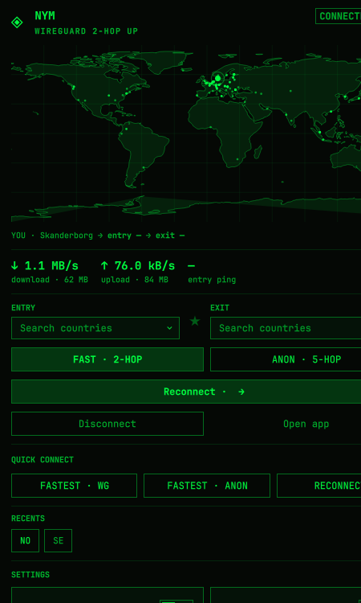

# NymVPN for Omarchy



A theme-native Omarchy bar widget and route panel for the NymVPN daemon. It uses the active Omarchy theme and does not include account credentials.

The bar chip reads `NYM` and opens the full control panel:

- **Route map** — a flat equirectangular map using Natural Earth 1:110m outlines and gateway locations from Nym's public directory. It draws **YOU → ENTRY → EXIT**; ANON · 5-HOP mode shows approximate intermediate relay positions because Nym selects those relays per connection.
- **Route cards and locations** — entry/exit country and city, with searchable country selectors, one-click favorite stars, and recently used gateways.
- **Connection controls** — FAST · 2-HOP (WireGuard) or ANON · 5-HOP (mixnet), fastest quick-connect, Connect / Reconnect / Disconnect, and Open app.
- **Settings** — LAN access, ad-block, IPv6, circumvention transports, netstack, anonymous network statistics, custom DNS presets or manual servers, SOCKS5 proxy, and split-tunnel excluded processes.
- **Account** — login with your recovery phrase, identity/subscription/quota/device status, log out, rotate keys.
- **Diagnostic** — one-click daemon diagnostic report (can take a few minutes).
- **Traffic stats** — interface rates, totals, and gateway ping while connected.

The location shown as **YOU** is best-effort: the helper queries Nym's public geo-IP endpoint when disconnected, then falls back to cached location or timezone data. While connected, it uses cached location rather than reporting the VPN exit as your position. The geo/route caches are written with 0600 permissions.

## Alongside the official NymVPN app

The plugin and the official app talk to the same daemon and can run at the same time. The daemon holds one shared config: whichever side changes a setting last is what both sides then show — the panel always re-reads daemon state after every action, so it never displays stale local overrides. The bar chip and traffic stats work even while the app owns the connection, because they read kernel interface state instead of the daemon socket. Connect or disconnect from either side; the other side updates via daemon events.

## Privacy

When the tunnel is down, the widget's 30-second status poll calls `https://nymvpn.com/api/public/v1/geo/ip`; that service receives the client's public IP. The returned IP and location are cached locally at `~/.cache/omarchy/nym-geo.json`. While connected, the helper does not call that geo-IP endpoint. The gateway directory is fetched from Nym's public API and cached for up to six hours. No runtime cache, account credentials, or user-specific route data is included in this repository.

## Requirements

- Omarchy with its Quickshell plugin support.
- NymVPN daemon installed and available as `nym-vpnd.service`.
- The bundled `bin/nym-vpnc` is the upstream NymVPN CLI v2026.12.4 for x86_64 GNU/Linux. Its separate GPL-3.0-only license and corresponding source are documented in [THIRD_PARTY_NOTICES.md](THIRD_PARTY_NOTICES.md).

## Install into Omarchy

```bash
omarchy plugin enable io.github.nostrdanish.nym-vpn
omarchy bar put io.github.nostrdanish.nym-vpn --section right
```

Keys in the panel: `C` connect, `D` disconnect, `R` refresh, `O` open app, `Q` fastest WireGuard, `X` fastest mixnet. Daemon actions run only after an explicit user action, never from the status timer.

## Daemon access note

The daemon accepts local clients from the **`nym-vpn` UNIX group** (or via a polkit prompt that no agent can answer on a minimal box). Add yourself once:

```bash
sudo usermod -aG nym-vpn $USER
```

Then log out and back in so the bar picks up the new group. Alternative without re-login:

```bash
echo 'polkit.addRule(function(a,s){ if (a.id == "com.nymvpn.vpnd.unix-access" && s.active) return polkit.Result.YES; });' | sudo tee /etc/polkit-1/rules.d/49-nymvpn.rules && sudo systemctl try-restart polkit
```

Without one of these, the bar chip and traffic stats still work (they read interface state only), but panel actions wait for an authorization nobody can answer; the panel shows the same fix when that happens. The recovery phrase is passed to the helper through the process environment, never via command-line arguments.

## Remove

```bash
omarchy plugin disable io.github.nostrdanish.nym-vpn
```

If a widget entry remains on the bar, remove the Nym VPN block from the bar layout (editable in Omarchy's bar settings, stored in `~/.config/omarchy/shell.json`). This only detaches the widget and the plugin; the NymVPN daemon and app packages stay installed. To remove those too: `sudo pacman -R nym-vpn-app-bin nym-vpnd-bin && sudo systemctl disable --now nym-vpnd.service`. Local caches at `~/.cache/omarchy/nym-*.json` can be deleted freely.

## Licensing

The plugin's original source is MIT-licensed; see [LICENSE](LICENSE). The bundled NymVPN CLI and Natural Earth datasets have separate third-party terms described in [THIRD_PARTY_NOTICES.md](THIRD_PARTY_NOTICES.md).
